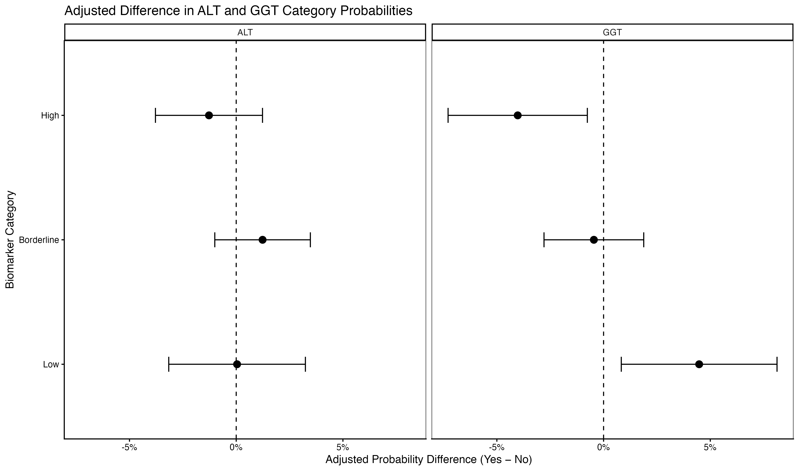
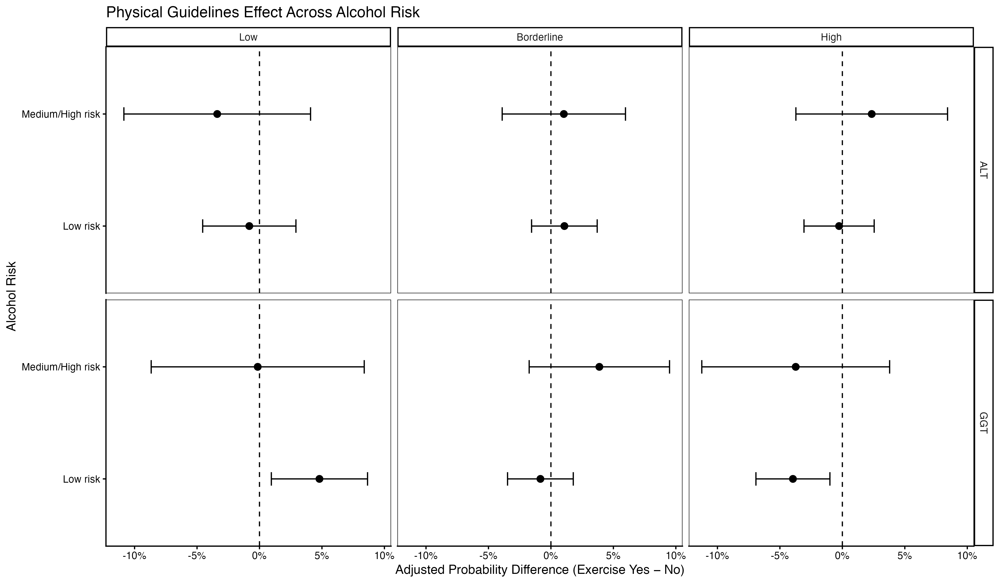

# AHS Liver Health Analysis

**Statistical Analysis of Lifestyle Factors and Liver Biomarkers Using the 2011–12 Australian Health Survey**

Research project completed for **STAT3888 Statistical Machine Learning** at the **University of Sydney (2026)**, as part of a collaborative STAT3888/NUTM3888 Group 1 project.

**Tools:** `R` `Quarto` `Tidyverse` `ggplot2` `Multinomial Logistic Regression` `Statistical Inference` `Machine Learning` `Causal DAGs`

**[Read the Final Research Report](group-1_finalReport.pdf)**

## Project Overview

This project investigates the associations between lifestyle factors and liver health among Australian adults using data from the **2011–12 Australian Health Survey (AHS)**, specifically its National Health Survey (NHS) component.

The study focuses on two liver biomarkers:

- **Alanine aminotransferase (ALT):** A biomarker associated with hepatocellular injury.
- **Gamma-glutamyl transferase (GGT):** A biomarker associated with liver function and oxidative stress, including responses to alcohol consumption and smoking.

The analysis examines how alcohol consumption, smoking duration, and physical activity relate to ALT and GGT concentrations, while accounting for relevant demographic, anthropometric, and socioeconomic factors.

Two complementary research questions were investigated using multinomial logistic regression, with biomarker outcomes classified into **Low, Borderline, and High** categories.

The overall findings indicate that **GGT exhibits more consistent associations with lifestyle factors than ALT**, particularly in relation to alcohol consumption, smoking duration, and physical activity.

## Research Questions

### Analysis 1: Alcohol Consumption, Smoking, and Liver Biomarkers

**How are alcohol consumption risk and smoking duration associated with ALT and GGT levels in Australian adults?**

This analysis examined:

- Associations between alcohol-risk categories and liver biomarker status.
- Trends in elevated biomarker probabilities across smoking-duration categories.
- Whether these relationships persist after adjusting for demographic and socioeconomic factors.
- Potential interactions between alcohol consumption and smoking duration.

The analysis used **4,766 complete-case observations** from the adult biomedical sample.

### Analysis 2: Physical Activity and Liver Biomarkers

**Is meeting physical activity guidelines associated with more favourable ALT and GGT levels after accounting for alcohol consumption, smoking history, and other potential confounders?**

This analysis examined:

- Differences in biomarker categories between adults meeting and not meeting physical activity guidelines.
- The extent to which adjusting for potential confounders changes the observed associations.
- Adjusted predicted probabilities of Low, Borderline, and High biomarker categories.
- Whether associations between physical activity and liver biomarkers vary across smoking-duration and alcohol-risk groups.

The analysis used **4,762 complete-case observations**.

This repository primarily contains the R/Quarto code developed for **Analysis 2**, alongside the collaborative final report covering both research questions.

## Data and Methodology

### 1. Data Preparation and Exploratory Analysis

Data were obtained from the **2011–12 National Health Survey component of the Australian Health Survey**, using person-level biomedical and survey records alongside household information.

The data preparation workflow involved:

- Cleaning and integrating relevant survey datasets.
- Linking person and household records using survey identifiers.
- Recoding survey-specific missing-value indicators.
- Constructing categorical ALT and GGT outcomes using sex-specific reference thresholds.
- Transforming age categories into numerical midpoint estimates and retaining numerical waist circumference measurements.
- Preparing alcohol-risk, smoking-duration, physical activity, and socioeconomic predictors.
- Investigating missingness, class distributions, and data availability.
- Constructing complete-case datasets for subsequent modelling.

The primary outcome variables, `ALT3` and `GGT3`, each contain three categories: **Low, Borderline, and High**.

The initial feasibility and exploratory investigations also considered restricted populations of smokers and medium/high-risk alcohol consumers. Subsequent modelling expanded to the broader adult sample to improve sample size and permit adjustment for smoking and alcohol consumption.

### 2. Multinomial Logistic Regression

Multinomial logistic regression was selected as the principal modelling framework, implemented in R using `nnet::multinom()`.

Ordinal logistic regression was initially investigated because the biomarker categories have a natural ordering. However, tests indicated violations of the proportional-odds assumption, motivating the use of multinomial models.

Separate models were fitted for ALT and GGT, using the **Low biomarker category as the reference outcome**.

For Analysis 2, two principal models were compared:

| Model | Description |
|---|---|
| Model 1 (Crude) | Physical activity guideline status as the sole predictor |
| Model 2 (Adjusted) | Physical activity guideline status with demographic, anthropometric, lifestyle, and socioeconomic covariates |

The adjusted model accounted for:

- Sex
- Alcohol consumption risk
- Smoking duration
- Non-school qualifications
- Income decile
- Age
- Waist circumference

Associations were summarised using odds ratios (ORs), 95% confidence intervals, and statistical significance tests.

### 3. Model Diagnostics and Sensitivity Analyses

Additional analyses investigated the suitability and robustness of the statistical models.

These included:

- Model convergence and goodness-of-fit measures.
- Sparsity and rank-deficiency checks.
- Multicollinearity assessment.
- Examination of influential observations.
- Case-deletion sensitivity analysis.
- Model evaluation using log loss and multiclass AUC.
- Comparisons between ordinal, multinomial, and alternative regression specifications.
- Exploratory missing-data sensitivity analysis using multiple imputation by chained equations (MICE).

Directed acyclic graphs (DAGs) were also developed to examine hypothesised relationships between physical activity, potential confounders, and liver biomarkers, supporting covariate selection and interpretation.

These investigations helped inform modelling choices and identify limitations of the statistical analysis.

### 4. Adjusted Probabilities and Interaction Effects

To improve interpretability beyond regression coefficients and odds ratios, the fitted multinomial models were used to estimate adjusted category probabilities.

In particular, the analysis calculated:

- Predicted probabilities of Low, Borderline, and High ALT/GGT for participants meeting versus not meeting exercise guidelines.
- Adjusted probability differences (Exercise Yes minus Exercise No).
- Confidence intervals and Holm-adjusted multiple comparisons.
- Subgroup-specific probability differences across smoking-duration categories.
- Subgroup-specific probability differences across alcohol-risk groups.

The interaction analyses investigated possible effect modification, rather than assuming that physical activity was associated with the same biomarker differences across all population subgroups.

### 5. Supplementary Machine Learning Investigations

In addition to the primary regression analyses, several alternative modelling approaches were explored during project development:

- **Decision Trees:** Classification trees with pruning and cross-validation.
- **Random Forests:** Ensemble classification, hyperparameter tuning, and variable importance.
- **Partial Dependence Plots:** Exploration of predictor relationships in fitted random forests.
- **Generalised Additive Models (GAMs):** Investigation of potential nonlinear associations, particularly involving numerical predictors in the revised dataset.
- **Alternative Regression Models:** Ordinal, binary logistic, continuation-ratio, and linear regression formulations.

These investigations were primarily exploratory or supplementary and should not be interpreted as replacements for the principal multinomial logistic regression results reported in the final paper.

## Key Findings

### Analysis 1: Alcohol and Smoking

The analysis identified stronger and more consistent associations between alcohol consumption, smoking duration, and **GGT** than with ALT.

Notable findings included:

- High-risk alcohol consumers exhibited **3.66 times the adjusted relative odds** of High versus Low GGT compared with low-risk consumers (95% CI: 2.57–5.22).
- The adjusted probability of High GGT increased from approximately **13.3%** among low-risk drinkers to **33.2%** among high-risk drinkers.
- Longer smoking duration was associated with an increasing trend in High GGT probability (linear trend p = 0.023), although the longest smoking-duration category had greater uncertainty.
- ALT associations were generally weaker and less consistent, with no comparable dose-response trend across alcohol-risk categories.

These results suggest that GGT may be more responsive to the lifestyle factors examined, although its interpretation is limited by its lack of specificity and the observational study design.

### Analysis 2: Physical Activity

The primary Analysis 2 findings indicated an association between meeting physical activity guidelines and more favourable GGT categories, after adjusting for the selected covariates.

#### Regression Results

The odds ratios below compare **not meeting** exercise guidelines with **meeting** the guidelines, using Low biomarker status as the outcome reference category.

| Outcome | Crude OR (95% CI) | Adjusted OR (95% CI) |
|---|---|---|
| High ALT vs Low ALT | 1.30 (1.09–1.55) | 1.11 (0.92–1.34) |
| High GGT vs Low GGT | 1.71 (1.44–2.03) | **1.35 (1.12–1.62)** |

After multivariable adjustment:

- The association between physical activity and High ALT was attenuated and no longer statistically significant (p = 0.2727).
- Not meeting exercise guidelines remained associated with **35% higher relative odds of High versus Low GGT** (p = 0.0014).
- Associations with the Borderline biomarker categories were not statistically significant.

#### Adjusted Probability Differences

The probability-scale analysis provided a more interpretable comparison of the exercise groups.

Meeting physical activity guidelines was associated with approximately:

- **+4.5 percentage points** in the adjusted probability of Low GGT.
- **−4.0 percentage points** in the adjusted probability of High GGT.

The corresponding ALT probability differences were comparatively small, with confidence intervals including zero.

*Adjusted probability differences (Exercise Yes minus No) for Low, Borderline, and High ALT/GGT categories. Points represent estimated differences with 95% confidence intervals. Positive values favour a higher probability among participants meeting exercise guidelines.*

#### Interaction Effects

Interaction models explored whether the exercise-associated biomarker differences varied by smoking duration or alcohol consumption risk.

- **Smoking duration:** No clear monotonic pattern of exercise-associated differences was observed across smoking-duration groups.
- **Alcohol consumption:** The most apparent GGT pattern was found among low-risk alcohol consumers, with higher probabilities of Low GGT and lower probabilities of High GGT among those meeting exercise guidelines.
- **Medium/high-risk alcohol consumption:** Estimates were less precise and generally compatible with no difference.

Overall, evidence of effect modification was limited and inconsistent, particularly in smaller subgroups.

*Exercise-associated differences in ALT and GGT category probabilities across alcohol-risk groups, with 95% confidence intervals.*

### Overall Conclusion

Across both analyses, **GGT demonstrated more consistent associations with lifestyle factors than ALT**.

Higher alcohol risk and longer smoking duration were generally associated with less favourable GGT categories, while meeting physical activity guidelines was associated with a greater probability of Low GGT and a lower probability of High GGT.

These are **observational associations, not established causal effects**. The cross-sectional survey design, reliance on self-reported lifestyle measures, complete-case analysis, and uncertainty within smaller subgroups limit causal interpretation and generalisability.

## Repository Structure

The repository contains the final collaborative research report, R/Quarto analysis scripts, supporting analysis documents, and selected figures.

### Final Research Report

- **[group-1_finalReport.pdf](group-1_finalReport.pdf)** — Final 19-page collaborative research report, covering both Analysis 1 and Analysis 2, including methodology, results, discussion, limitations, and references.

### R/Quarto Source Code

The [`Code/`](Code/) directory contains the analysis scripts and exploratory investigations.

| File | Description |
|---|---|
| [NHSAnalysis.qmd](Code/NHSAnalysis.qmd) | Initial Australian NHS data cleaning, variable processing, and exploratory analysis |
| [FeasibilityAnalysisQ1b.qmd](Code/FeasibilityAnalysisQ1b.qmd) | Initial feasibility investigation, missing-data analysis, descriptive statistics, and preliminary models |
| [FullPopulationFAQ1b.qmd](Code/FullPopulationFAQ1b.qmd) | Extension of preliminary regression analyses to the broader adult population |
| [ModelDiagnosticsQ2.qmd](Code/ModelDiagnosticsQ2.qmd) | Multinomial model diagnostics, influence analysis, sensitivity checks, and evaluation metrics |
| [InteractionEffect.qmd](Code/InteractionEffect.qmd) | Initial full-population interaction modelling involving smoking and alcohol risk |
| [OrdinalLogisticRegressionQ2.qmd](Code/OrdinalLogisticRegressionQ2.qmd) | Ordinal regression and proportional-odds assumption investigations |
| [NonlinearAnalysis.qmd](Code/NonlinearAnalysis.qmd) | Classification trees, random forests, cross-validation, and partial dependence plots |
| [SensitivityAnalyses.qmd](Code/SensitivityAnalyses.qmd) | Sensitivity analysis of household smoking covariates and MICE imputation |
| [CausalInference.qmd](Code/CausalInference.qmd) | Initial DAG modelling, marginal-effects exploration, and propensity-score investigations |
| [ReformedAnalysisQ2.qmd](Code/ReformedAnalysisQ2.qmd) | Post-feedback data and model revisions, including alternative model specifications and sensitivity analyses |
| [CausalInferenceRework.qmd](Code/CausalInferenceRework.qmd) | Revised causal DAG incorporating the updated covariate definitions |
| [Q2Visualisations.qmd](Code/Q2Visualisations.qmd) | Final Analysis 2 tables, adjusted probabilities, odds ratios, and interaction visualisations |
| [MLRModelPerformance.qmd](Code/MLRModelPerformance.qmd) | Cross-validated multinomial model evaluation using AUC, log loss, and balanced accuracy |

Some scripts document intermediate stages of the research process, including earlier variable definitions and models that were subsequently revised.

### Supporting Documents

The [`PDFs/`](PDFs/) directory contains supplementary outputs, exploratory reports, diagnostic summaries, and material prepared throughout the project.

**Feasibility, regression, and model diagnostics**

- [Initial feasibility analysis](PDFs/FeasibilityAnalysisQ1b.pdf)
- [Full-population feasibility analysis](PDFs/FullPopulationFAQ1b.pdf)
- [Multinomial model diagnostics](PDFs/ModelDiagnosticsQ2.pdf)
- [Ordinal logistic regression](PDFs/OrdinalLogisticRegressionQ2.pdf)
- [Interaction-effect analysis](PDFs/InteractionEffect.pdf)
- [Model performance evaluation](PDFs/NewModelPerformance.pdf)

**Post-feedback and supplementary analyses**

- [Post-feedback revisions](PDFs/Post-FeedbackRevision.pdf)
- [Sensitivity analyses](PDFs/SensitivityAnalyses.pdf)
- [Nonlinear analysis and machine learning](PDFs/NonlinearAnalysis.pdf)
- [Causal inference analysis](PDFs/CausalInference.pdf)
- [Revised causal inference analysis](PDFs/CausalInferenceRework.pdf)
- [Causal inference supplement with sources](PDFs/Causal%20Inference%20Supplement%20with%20Sources.pdf)
- [STAT3888 causal inference notes](PDFs/STAT3888_Causal_Inference.pdf)

**Tables and visualisations**

- [Analysis 2 visualisations](PDFs/Q2Visualisations.pdf)
- [Analysis 2 tables and plots](PDFs/STAT3888_Q2_Tables_and_Plots.pdf)

### Figures

The [`Images/`](Images/) directory contains selected Analysis 2 visualisations:

| Figure | Description |
|---|---|
| [Adjusted probabilities](Images/adjusted_probabilities.png) | Adjusted probabilities of ALT/GGT categories by exercise-guideline status |
| [Probability differences](Images/probability_differences.png) | Adjusted Exercise Yes minus No probability differences |
| [Smoking interaction differences](Images/smoking_interaction_differences.png) | Exercise-associated differences across smoking-duration groups |
| [Alcohol interaction differences](Images/alcohol_interaction_differences.png) | Exercise-associated differences across alcohol-risk groups |

## Software and Packages

The project was developed primarily in **R**, with reproducible analysis documents written in **Quarto**.

Major packages used across the research workflow include:

| Purpose | R Packages |
|---|---|
| Data manipulation and visualisation | `tidyverse`, `ggplot2`, `dplyr`, `patchwork` |
| Multinomial and alternative regression | `nnet`, `MASS`, `ordinal`, `VGAM` |
| Regression diagnostics and inference | `broom`, `car`, `performance`, `emmeans`, `marginaleffects` |
| Missing-data analysis and imputation | `naniar`, `mice` |
| Causal DAGs and related analysis | `dagitty`, `ggdag`, `WeightIt`, `cobalt` |
| Machine learning and model evaluation | `caret`, `rpart`, `rpart.plot`, `randomForest`, `pdp`, `pROC` |
| Nonlinear regression | `mgcv` |
| Reporting and tables | `knitr`, `kableExtra`, `stargazer` |

Not every package is required for every analysis script.

## Data Availability and Reproducibility

The original Australian Health Survey microdata and intermediate R data objects are **not included** in this repository.

The Quarto scripts reference source datasets, cleaned `.rds` objects, and fitted model objects generated during the original analysis workflow. Consequently, the scripts are provided primarily as documentation of the statistical methods and computational investigations, rather than as a fully self-contained executable pipeline.

Reproducing the analyses requires appropriate access to the underlying Australian Health Survey data, reconstruction of the data-processing steps, and installation of the relevant R packages.

For a complete presentation of the methodology, numerical results, and scientific conclusions, consult the [final research report](group-1_finalReport.pdf).

## Project Attribution

This research was completed collaboratively by **STAT3888/NUTM3888 Group 1** in Semester 2, 2026.

The repository is maintained as a personal portfolio of the statistical and computational work conducted during the project, primarily featuring the code developed for **Analysis 2: Physical Activity and Liver Biomarkers**.

My contributions included:

- Data preparation, feasibility investigations, and exploratory statistical analysis.
- Development and diagnostic assessment of multinomial regression models for physical activity and liver biomarkers.
- Investigation of alternative regression methods, missing-data sensitivity, causal DAGs, and supplementary machine learning approaches.
- Construction of adjusted probability estimates, contrasts, interaction analyses, tables, and visualisations.
- Writing of the Analysis 2 statistical methods and results, alongside synthesis and preparation of the final collaborative research report.

Analysis 1 and the broader scientific discussion were completed collaboratively as part of the group project. The complete report retains the original project authorship and contribution acknowledgements.

## License

This repository includes an [MIT License](LICENSE) for the code and materials where the repository maintainer has the necessary rights to license them. The final collaborative report retains its original authorship, and use of the underlying survey data remains subject to applicable data-access conditions.
